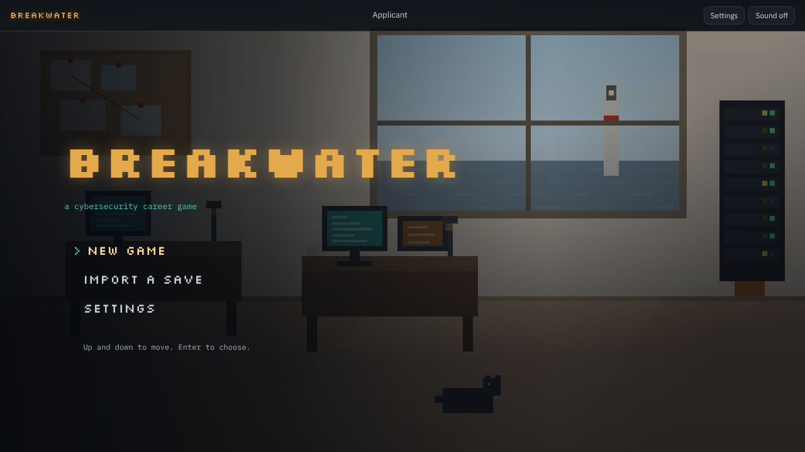
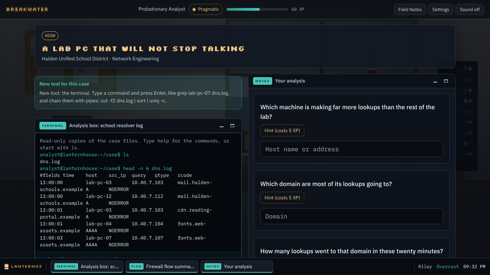
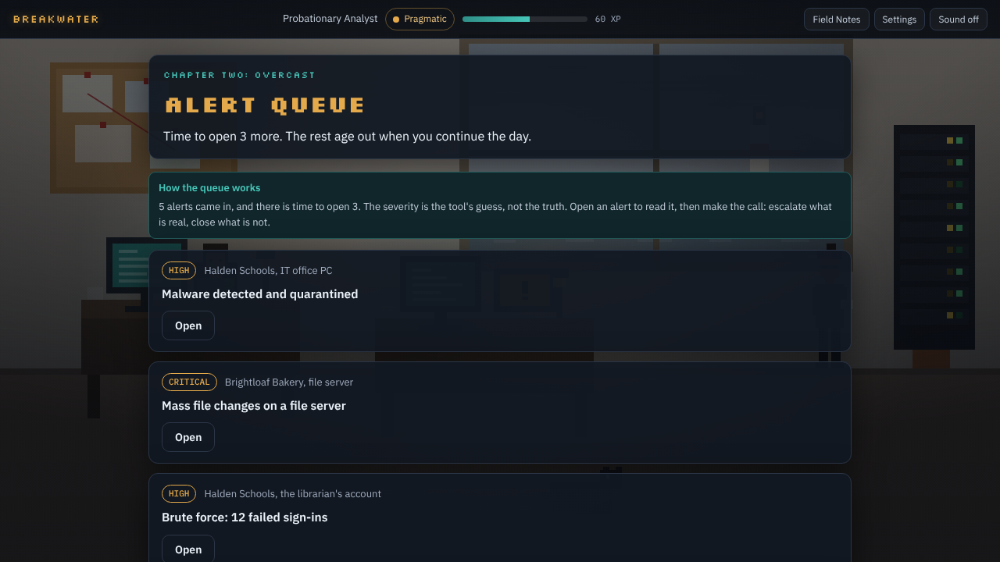

<h1 align="center">BREAKWATER</h1>

<p align="center">A cozy-to-dark cybersecurity career game. Get hired, work the cases, and find out what the quiet has been hiding.</p>

<p align="center">
  <a href="https://github.com/CyberAhmedX/BREAKWATER/releases/latest"><b>Download for Windows, macOS and Linux</b></a>
  &nbsp;&middot;&nbsp;
  <a href="https://cyberahmedx.github.io/BREAKWATER/"><b>Play the demo in your browser</b></a>
  &nbsp;&middot;&nbsp;
  <a href="#screenshots">Screenshots</a>
  &nbsp;&middot;&nbsp;
  <a href="#why-play-it">Why play it</a>
  &nbsp;&middot;&nbsp;
  <a href="#run-it-locally">Run it</a>
</p>

<p align="center">
  
</p>

<p align="center"><i>A breakwater holds the storm back so the harbor stays calm. Lanternhouse Security is the breakwater.</i></p>

---

It is your first week at Lanternhouse Security, a small firm that keeps a rainy harbor town online. The coffee is terrible and the people are good. The tickets are small: a strange email, a printer that allegedly has a virus.

Then the weather turns, and the tickets stop being small.

You read the evidence, work the tools, and make the call. Some calls are technical. Others are about what kind of analyst you are going to be, and those are the ones the ending remembers.

Breakwater is made for students and people getting ready for a first SOC or help desk job. Every case is invented, but each is modelled on a kind of incident a first-year analyst really meets, and it explains itself as you go. If you already do this for a living, Hard mode takes the hints away, gives you one attempt per case, and tightens the clock at the end.

## Get the game

- **The full game** is a free download for Windows, macOS and Linux, from the [latest release](https://github.com/CyberAhmedX/BREAKWATER/releases/latest).
- **The demo** runs [in your browser](https://cyberahmedx.github.io/BREAKWATER/) with nothing to install: the screening and the first two chapters. Export your save at the end and import it into the full game to carry on where you stopped.

## Screenshots

No case is given away here. Every picture is from the first two chapters or shows only the room.

| It opens on a quiet morning | Pick a team and get screened for it |
| :---: | :---: |
|  |  |
| **The main menu** | **Six teams, each with its own screening** |

| The office is your desk | Your first case |
| :---: | :---: |
|  |  |
| **Your screen, the alert screen and the corkboard all open something** | **Evidence on one side, your analysis on the other** |

| A desktop to work on | More alerts than there is time for |
| :---: | :---: |
|  |  |
| **Evidence opens in windows, here a terminal** | **Five came in. You have time to open three** |

| It starts cozy and sunlit. It does not stay that way |
| :---: |
|  |
| **Chapter Five: Storm Surge** |

## Why play it

- **You do the work, not just answer questions about it.** Cases hand you a tool and a pile of evidence, and you find the answer in it. Type a command, run a search, write a rule, then point at the line that proves what you think happened.
- **Your team is your game.** Screen for one of six teams: SOC, Network, Help Desk, Forensics, Pentest or Threat Intel. Your team gives you its own cases, its own tools, its own hard choice, its own part in the finale, and a secret only that team can find. A second run on another team is a different job.
- **There is never enough time.** From chapter two, alerts arrive faster than you can open them. The tool gives each one a severity, and the tool is guessing. What you catch, and what you let slide, comes back later.
- **You cannot memorise it.** Ten cases are built fresh each run, with new addresses, accounts, times and culprits. Playing again means reading the evidence again.
- **The room tells the story too.** You work in a small pixel office with your team lead at the next desk and a cat on the floor. The light, the weather outside the window and the music all change as the chapters darken.
- **Your choices stick.** There are five endings. What you do along the way decides which of them are still open when you get there, and the game tells you which choice closed a door.
- **It ends against the clock.** Your team's last case is live and timed, and wrong moves cost you seconds.
- **It teaches as it goes.** Field Notes unlock a plain explanation of each idea the first time you meet it. Hints exist, and cost XP, so reading is always cheaper than guessing. Solved cases are tagged with the MITRE ATT&CK technique they covered.

## What it is, exactly

So you know what you are downloading:

- **It is an investigation game played through text and tool screens**, over a pixel-art office. You do not walk a character around.
- **One playthrough is 13 cases over five chapters**: four that every player gets, four that belong to your team, and five optional side cases.
- **You get one team's tools per run.** Nobody sees every tool in one playthrough. Seeing all of them means playing all six teams.
- **The tools are simulations built into the game**, not the real products. The terminal takes real command syntax and the SIEM takes Splunk-style queries, but both work only on the case's own invented files and logs.
- **It is part hands-on, part multiple choice.** In a run, roughly four questions in ten are multiple choice. The rest ask you to type what you found, point at the evidence that proves it, put steps in order, or do a job on a tool.
- **Finishing it is not a qualification.** It is practice at reasoning through an investigation.

## Your team's tools

Everyone gets a terminal case, raw email headers to read, and logs, traffic summaries and chat transcripts as evidence. The rest depends on the team you join.

| Team | Its tools |
| :-- | :-- |
| **SOC** | A SIEM you search with queries in the style of `field=value \| stats count by field \| sort -count`, and a detection rule editor that tests your rule against a replay of attacks and false alarms. |
| **Network** | A firewall editor. Write rules in order, replay the traffic, and watch each flow get allowed or blocked. The first matching rule wins, as on a real firewall. |
| **Help Desk** | An admin console for containing a compromised account, where the order you do things in matters. An incident report you write in your own words. |
| **Forensics** | A timeline builder that merges logs stamped by different clocks onto one. More terminal work, with file hashes and file signatures. An incident report of your own. |
| **Pentest** | A scope checker that holds you to the engagement letter. A request editor for testing a fictional web application. A CVSS calculator that scores your findings by the published v3.1 formula. |
| **Threat Intel** | A pivot board for following infrastructure through passive DNS. Indicator extraction and defanging for a block list. ATT&CK mapping, with an offline matrix to look techniques up in. |

## Also in the box

- **A side case in every chapter**, smaller and stranger than the main ones.
- **An in-game desktop**: each piece of evidence opens in its own window, with a taskbar, and minimize and maximize for when a tool wants the whole screen. The windows are tiled, not free-floating.
- **Original music and sound, all synthesized as you play**: the soundtrack, the rain, the hum of the server rack, a keyboard across the room. Nothing is sampled.
- **Hard mode** for people who already know the trade, and **practice mode** to replay any case you have closed without touching your run.
- **Chapter replay** after your first ending, an endings gallery, and a share card of how your run ended.
- **A skills summary** of the tools you actually used and the techniques your cases covered. It is a record of a game, not a certificate, and it says so.
- **13 achievements** for how you played, and a hidden case file for each team.
- **XP and ranks**, from Probationary Analyst to Lead Analyst.
- **Take-home files** from some finales, to keep or adapt.
- **Saves you can export and import**, as a file or a short code.
- **Settings** for music and effects volume, text size, reduced motion, relaxed timers and fast dialogue.
- **No account, no network, no tracking.** The game runs offline.

## Everything here is fictional and safe

Every company, person, address, and domain is invented. All IP addresses come from documentation ranges (192.0.2.0/24, 198.51.100.0/24, 203.0.113.0/24) or private ranges, all domains use the reserved `.example` and `.test` TLDs, and no link points at a real system. The test suite checks all of this.

## Run it locally

```bash
npm install
npm run dev      # local dev server
npm run build    # the full game as one self-contained HTML file in dist/
npm run check    # lint + typecheck + tests
npm run e2e      # plays the built game in Chromium: every ending, every track
```

### The desktop app

The same build also runs as a PC game, in its own window, through [Tauri](https://tauri.app). It runs on Windows, Linux and macOS. To build it you need [Rust](https://rustup.rs) installed, and on Linux the WebKitGTK development libraries.

```bash
npm run desktop:dev     # the game in a native window, with live reload
npm run desktop:build   # an installer in src-tauri/target/release/bundle/
```

F11 or Alt+Enter toggles fullscreen, downloads open a native "Save as" dialog, and the main menu has a way to quit. Tagging a release builds and attaches:

| System | File |
| :-- | :-- |
| Windows 10 and 11 | `.exe` installer |
| Linux | `.deb`, `.rpm` and a portable `.AppImage` |
| macOS 10.15 and later, Apple silicon and Intel | `.dmg` |

The installers are not code signed. Windows asks before running one for the first time, and on macOS you right-click the app and choose Open the first time (or allow it under System Settings, Privacy & Security).

The website is built with `VITE_DEMO=1 npm run build`, which stops after chapter two and points to the download. Every other build, the desktop app included, is the full game.

The production build is one self-contained `dist/index.html` of about 800 KB, fonts included. It makes no network requests, so it works offline and can be hosted anywhere.

## Project layout

```
src/
  engine/    state, saves, ranks, flags, ending logic (pure, unit tested)
  scene/     the pixel office, chapter moods, character portraits
  audio/     the generative soundtrack and sound effects
  ui/        one file per screen (title, screening, desk, case, alert queue,
             dialogue, overlays) plus the evidence viewers and tools
  content/   all writing: screenings, tickets, alert queue, scenes, codex,
             and the generators for cases that change between runs
tests/       content house-rules and engine logic
e2e/         a bot that plays the real game in a browser
src-tauri/   the desktop shell: window, icons, save dialog, fullscreen, quit
media/       screenshots and the demo clip
```

## Tech

TypeScript, Vite, Vitest, Playwright, ESLint, and Tauri for the desktop app. No game engine and no runtime framework. CI runs lint, typecheck and tests on every push, then plays the built game in a real browser to every ending; a push to main deploys the demo to GitHub Pages, and a version tag builds the installers.

See `CREDITS.md` for asset provenance and `PRIVACY.md` for the privacy note.

## License

All rights reserved. See `LICENSE`.
